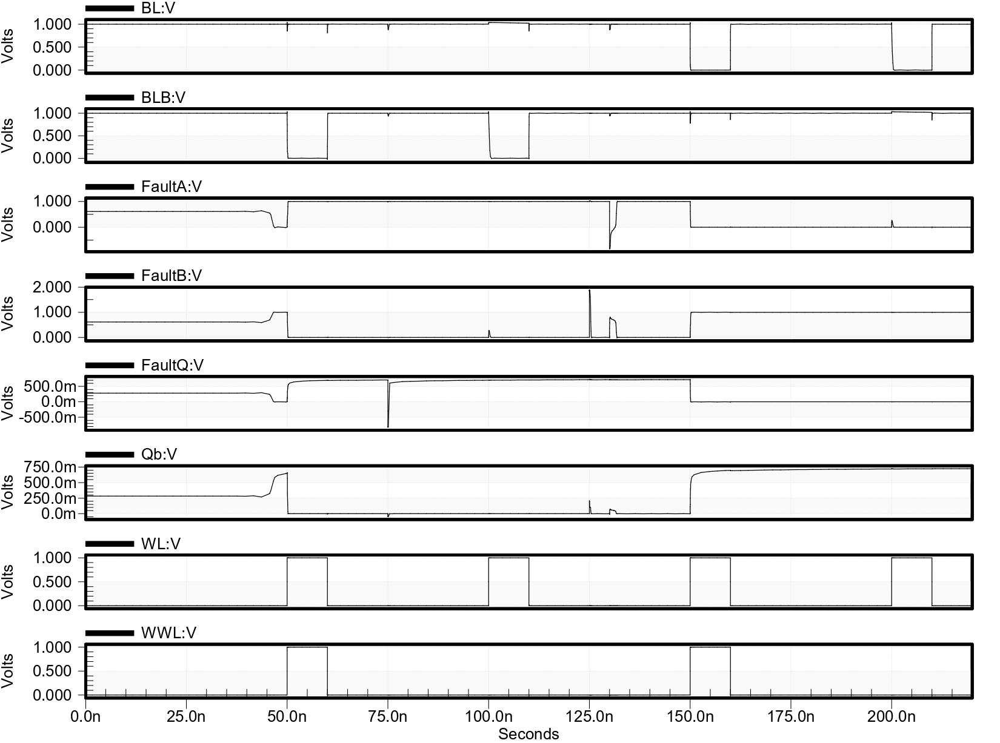
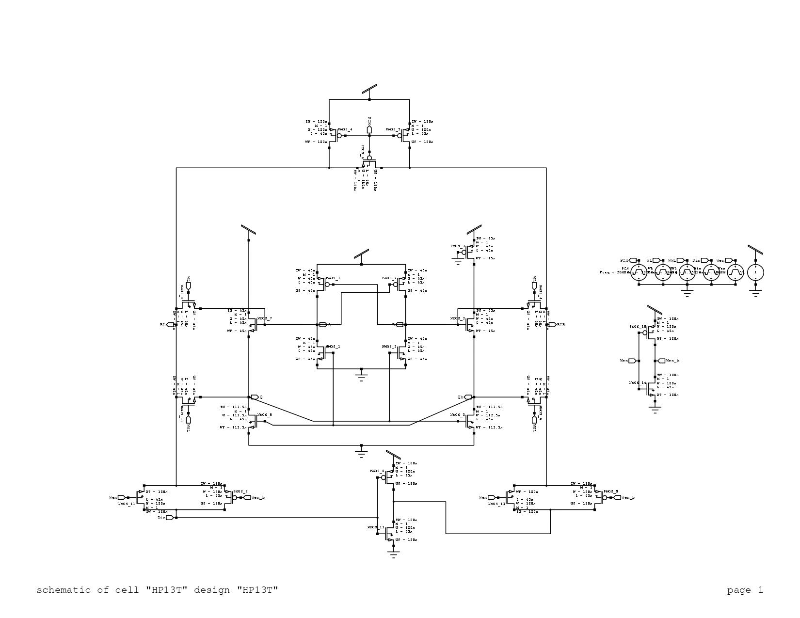
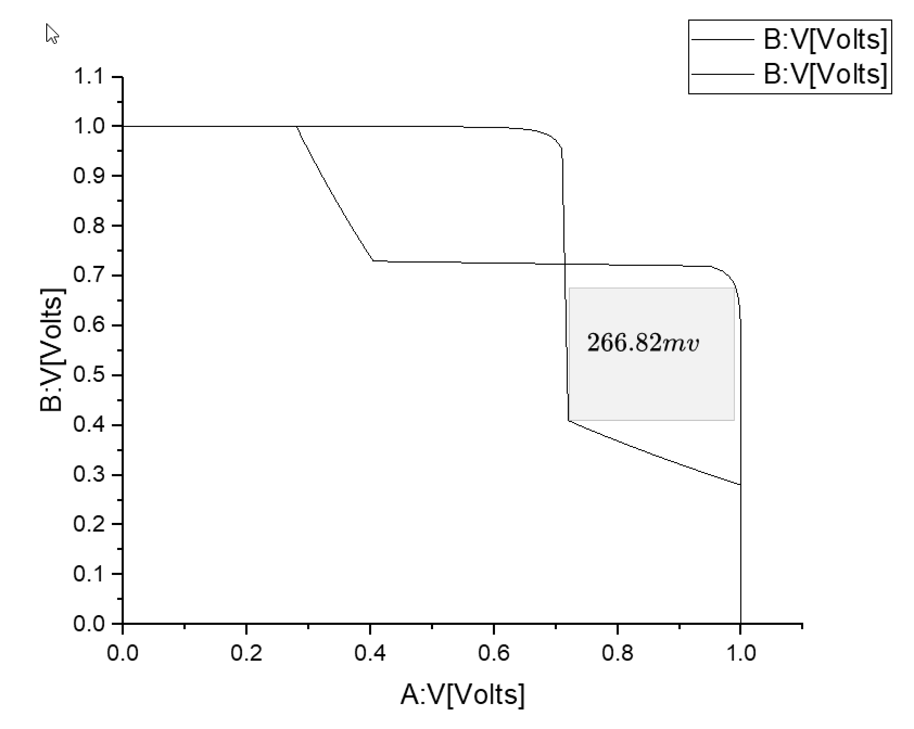
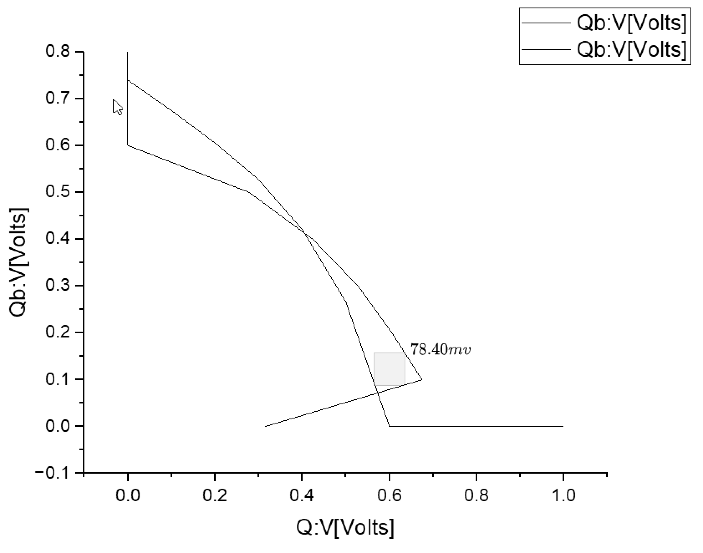

# HP13T: an experiment on a radiation-hardened SRAM cell

Summer research internship, NIT Rourkela, Department of Electronics and Communication Engineering,
17 May to 18 July 2024, under Dr. Atin Mukherjee. 45 nm CMOS, Tanner S-Edit and T-Spice 16.3.

## Why these cells exist

A particle strike (a heavy ion in orbit, an atmospheric neutron at flight altitude, an alpha particle from the
package) can deposit enough charge on an SRAM storage node to flip the stored bit: a single-event upset. The
charge needed to flip it, the critical charge, shrinks as nodes get smaller. In space this is routine: the
TDRS-1 satellite saw RAM upsets from about one per day to several hundred per day during solar particle
events ([Dyer et al., ICAS 2000](https://icas.org/ICAS_ARCHIVE/ICAS2000/PAPERS/ICA0644.PDF)). At cruising
altitude the radiation is several hundred times ground level, so avionics see it too.

Radiation hardening by design adds feedback transistors inside the cell so a struck node gets pulled back to
its correct value. The cost is more transistors, so more area and more leakage. People spend whole PhDs on
this trade-off.

## What I did in two months

1. **Baseline.** Built a conventional 6T cell ([6T-SRAM](https://github.com/JaiminKadiwal/6T-SRAM)) to have
   reference numbers.
2. **Reproduced a published cell.** Rebuilt HP16T from my supervisor's group
   ([HP16T repo](https://github.com/JaiminKadiwal/HP16T-SRAM-cell-with-fault-tolerance)): S. Kumar and
   A. Mukherjee, "High performance radiation-hardened SRAM cell design for robust applications",
   *Microelectronics Journal* 140, 105934 (2023). Measured access time, power and noise margins, and checked
   upset recovery with fault injection.
3. **Tweaked it to learn.** Removed 3 transistors from HP16T's internal feedback, kept the read and write path
   the same, and measured what changed. That is HP13T, this repo. It is an experiment to see what those
   transistors do, not a new architecture.

## Results

Same testbench (pre-charge and write drivers) for all three cells. VDD = 1 V.

| Metric | 6T | HP16T | HP13T | HP13T vs HP16T |
|---|---|---|---|---|
| Transistors | 6 | 16 | 13 | 3 fewer |
| Read access time (ps) | 6.46 | 16.74 | 16.79 | same (+0.3%) |
| Write access time (ps) | 189.35 | 68.71 | 68.97 | same (+0.4%) |
| Static power (nW) | 21.80 | 35.45 | 33.96 | 4.2% lower |
| Dynamic power (nW) | 115.94 | 94.43 | 92.82 | 1.7% lower |
| Read SNM (mV) | 144 | 201.31 | 266.82 | 32.5% higher |
| Hold SNM (mV) | 275.70 | 217.32 | 78.40 | 64% lower |

What the numbers say:
- Access times did not move, because the removed transistors are not in the read or write path.
- Fewer transistors means less leakage, so static power dropped.
- Read stability improved, but hold stability fell sharply, from 217 to 78 mV. The removed transistors were
  doing real work while the cell holds its value. That trade-off is the main thing this experiment taught me.

## Upset recovery

Faults injected one node at a time: Q at 75 ns, B at 125 ns, A at 130 ns. Each node is kicked away from its
value and the cell pulls it back; the stored data is not lost.

| Schematic | Read SNM (butterfly) | Hold SNM (butterfly) |
|---|---|---|
|  |  |  |

Read and write waveforms: [docs/read_write_waveform.png](docs/read_write_waveform.png).

## What I did not measure

Write SNM, critical charge, upsets on two nodes at once, layout area, process corners and Monte Carlo,
temperature and supply sweeps, and array-level behavior. A real evaluation of a hardened cell needs all of
these; this was a two-month learning project.

## Files

`HP13T/` holds the Tanner S-Edit project: open `HP13T.tanner` in Tanner Tools 16.3. `design.edif` is the
schematic netlist. The library paths in `libraries.list` point to the standard Tanner 16.3 example libraries.
